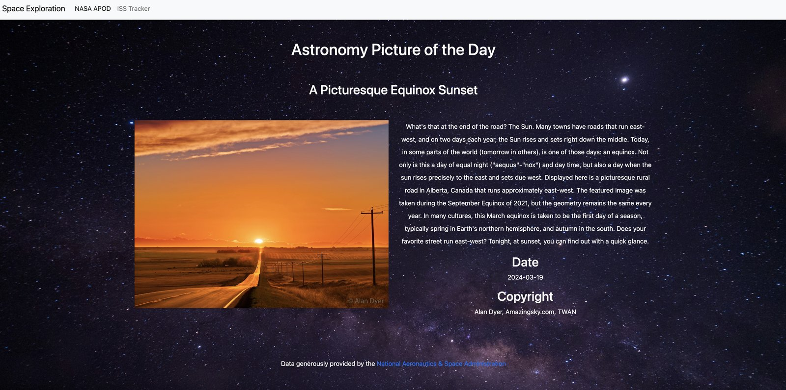
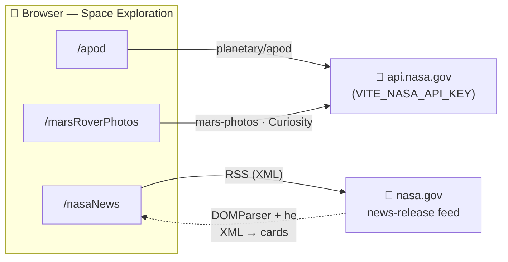

<p align="center">
  
</p>

<p align="center">
  
  
  
  
  
</p>

# Space Exploration

A dark, space-themed web app that brings NASA's publicly available data into one place: the Astronomy Picture of the Day, photos taken by the Curiosity rover on Mars, and the latest NASA news releases.

<p align="center">
  
  <br><sub>The Astronomy Picture of the Day page with live NASA data.</sub>
</p>

## Features

<p align="center">
  
</p>

- **Astronomy Picture of the Day (APOD).** Today's image from NASA, with its title, date and explanation. When the day's entry is a YouTube video, it plays inline instead.
- **Mars Rover Photos.** A responsive grid of photos from the Curiosity rover, each labelled with the camera that took it and the Earth date.
- **NASA News.** The latest NASA news releases from the official RSS feed, with titles, dates, summaries and links to the full story.
- **Built for the dark.** A dark MUI theme with periwinkle (`#8f9cec`) and deep violet (`#651fff`) accents and Montserrat type. The navigation collapses into a drawer on small screens.

## How it works

Everything runs in the browser and calls NASA directly. There is no backend.



## Tech stack

React 18, TypeScript, Vite 5, MUI 5, React Router, Axios, `react-player` for APOD videos and `he` for decoding feed text.

## Getting started

### Prerequisites

- Node.js (a current LTS release)
- A free NASA API key from https://api.nasa.gov

### Install and run

```bash
git clone https://github.com/jlthompson96/Space_Exploration.git
cd Space_Exploration
npm install
echo "VITE_NASA_API_KEY=your_key_here" > .env.local
npm run dev
```

Open the URL Vite prints (usually http://localhost:5173) and pick a page from the top bar.

NASA's `DEMO_KEY` also works for a quick look, with much lower rate limits.

## Scripts

| Command | Description |
| --- | --- |
| `npm run dev` | Start the Vite dev server |
| `npm run build` | Type-check and build for production into `dist/` |
| `npm run preview` | Serve the production build locally |
| `npm run lint` | Run ESLint |

## Project structure

```
src/
├── App.tsx              # Dark MUI theme (Montserrat, #8f9cec / #651fff)
├── components/
│   ├── Header.tsx       # App bar, mobile drawer and routes
│   ├── APOD.tsx         # Astronomy Picture of the Day (image or video)
│   ├── MarsPhotos.tsx   # Curiosity rover photo grid
│   └── NASANews.tsx     # NASA news-release RSS feed
└── common/Types.tsx     # Shared types
```

## Future plans

- [ ] Add more data to the site
- [ ] Add Mars weather
- [ ] More photos from the Curiosity rover
- [ ] Rework the site layout
